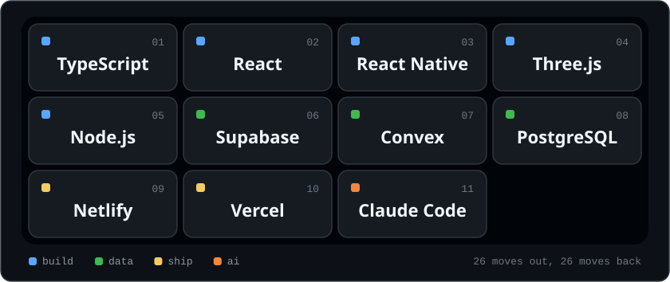

  

## About

I came up through marketing technology (Salesforce, Pardot, automation, attribution) and somewhere along the way started building the tools I wished I had. Now I ship full products with AI-augmented development, mostly in TypeScript.

I like problems that click into place: a data model that finally fits, a scoring rule with no edge cases left, the last layer of a cube.

## What I'm building

| Project | What it is |
| --- | --- |
| **CoachClick** | A platform for coaches and their teams. My main focus right now. |
| **Tomorrow: Daily Calls** | A daily prediction game. Five yes/no calls about tomorrow, scored against the crowd and the AI. |
| **The Tuesday Report** | A fantasy football companion with live scoring, draft report cards, and AI-written weekly recaps for Sleeper and ESPN leagues. |
| **FORGE** | A React Native app for tracking the 75 Hard challenge: daily progress, workouts, and nutrition. |
| **[Raceday](https://github.com/trevsky25/Raceday)** | Season-long race pool manager, built for a real 102-player NASCAR pool. |

I also run **[Kist Digital](https://kistdigital.com)**, where I build sites and tools for other people.

## Stack

  

## Side quests

  

The things I build because they're fun, which is most of the reason to build anything.

- **[MarbleRoller](https://github.com/trevsky25/MarbleRoller)**: a marble physics game in TypeScript and Three.js
- **[TiltWorld](https://github.com/trevsky25/TiltWorld)** and **[Forest-Explorer](https://github.com/trevsky25/Forest-Explorer)**: small 3D worlds in the browser
- **[Hollowfer](https://github.com/trevsky25/Hollowfer)**: a game project in C#
- A 3D model railway workshop with generated layouts, elevated tracks, and trains

## How I work

- **Ship the small version first.** Then find out what people actually do with it.
- **Build for a real person.** Most of my projects started with a friend, a league, or a team that needed something.
- **AI does the typing. I own the decisions.**

<b>How the graphics on this page work</b>

 

None of them are GIFs or videos, and nothing here runs JavaScript. Each one is a single SVG, generated by [`tools/build.py`](tools/build.py), that plays back a real simulation using only CSS.

- **The cube** repeats four moves, <kbd>R</kbd> <kbd>U</kbd> <kbd>R′</kbd> <kbd>U′</kbd>. Do that sequence six times on any cube and it returns to exactly where it started, which is why the loop is seamless. The script tracks all 26 pieces, projects each turn in 3D, and bakes 144 frames into the file.
- **The stack** is a real sliding puzzle. The script scrambles it with a random walk of the empty square, then solves it by walking the same path back.
- **The maze** is carved by depth-first search and solved by breadth-first search. The cells light up in the order the search visited them, and the yellow line is the shortest route it found.

## Contact

Got a team, a league, or an idea that needs a tool? Find me at **[kistdigital.com](https://kistdigital.com)**.
